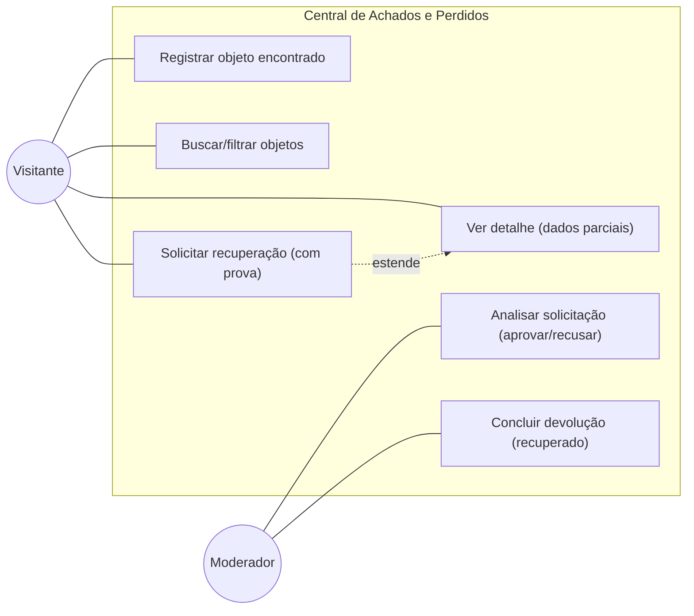
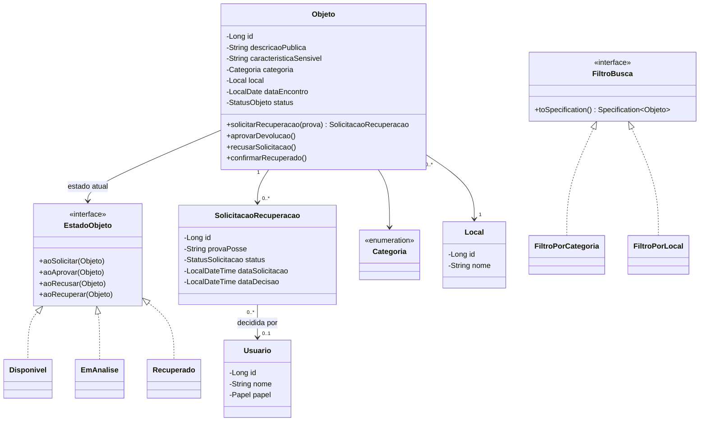
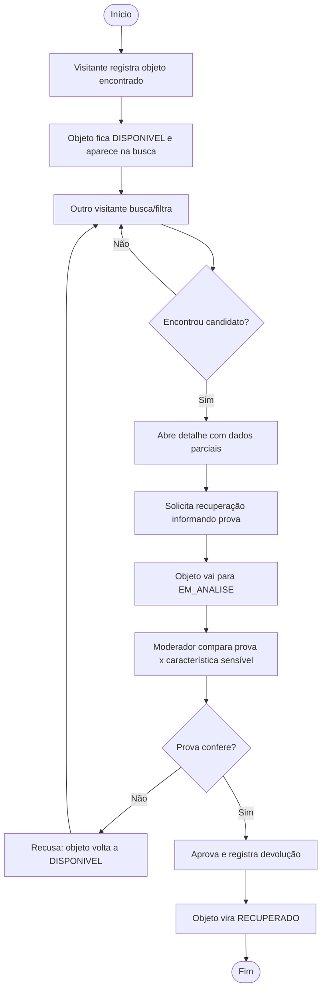
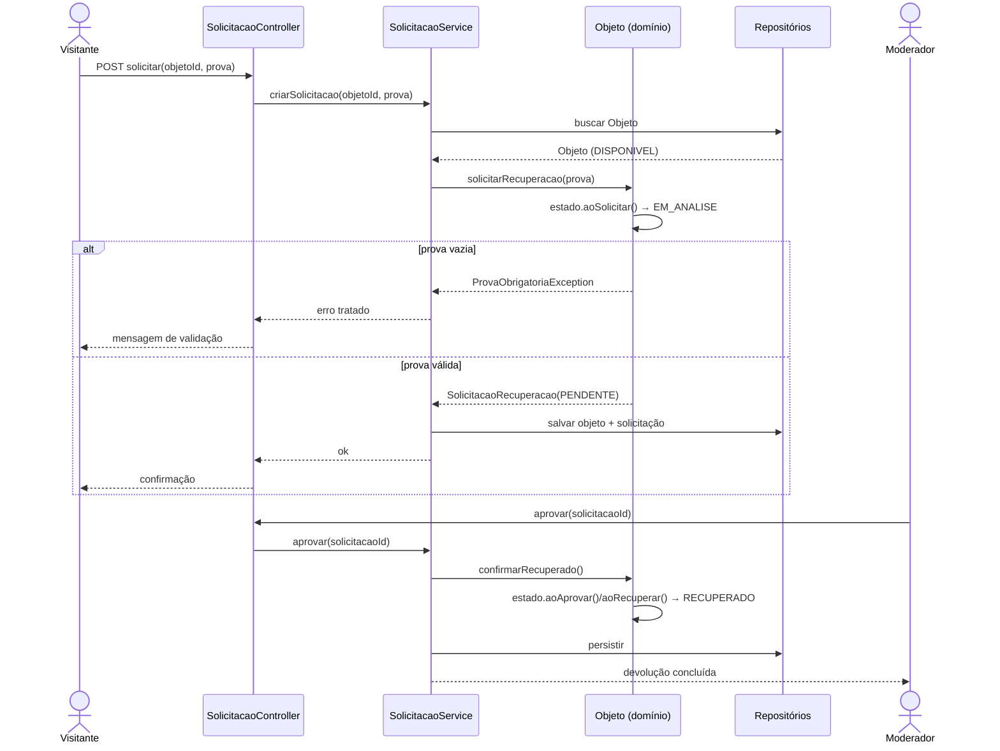

# 08 — Modelagem UML

Os diagramas estão em Mermaid (renderizam no GitHub) e também exportados em PNG na pasta `diagrams/`. Cada elemento corresponde a uma necessidade real já definida nos requisitos e regras.

## Diagrama de Casos de Uso
Atores: **Visitante** (comunidade) e **Moderador**.

## Diagrama de Classes (domínio)

Observações:
- `caracteristicaSensivel` nunca é exposta na apresentação (RN05); serve de base para conferir a `provaPosse`.
- `EstadoObjeto` concentra as transições (padrão **State**); `Objeto` delega para o estado atual.
- `FiltroBusca` é o padrão **Strategy** sobre a Specification API do Spring Data.

## Diagrama de Atividades — fluxo principal

## Diagrama de Sequência — solicitar e aprovar recuperação

## Rastreabilidade UML → requisitos
- Casos de uso UC1–UC6 ↔ RF01–RF07.
- `EstadoObjeto` e as transições ↔ RN03–RN09.
- `caracteristicaSensivel`/`provaPosse` ↔ RF04/RF05 e H4 (diferencial validado).
